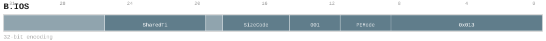
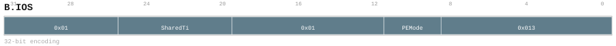

# B.IOS

<div class="insn-header">

<span class="badge-32">32-bit Base</span> **Group:** <a href="../groups/bundle_input_output.md">Bundle Input & Output</a> &nbsp;|&nbsp;
<span class="ch-tag ch-tag-04">Ch 04</span>
&nbsp; <strong>Block ISA — Block-structured Control Flow</strong> &nbsp;|&nbsp;
**Length:** <code>32</code> &nbsp;|&nbsp; **Decode:** <code>—</code>

</div>

## Assembly Syntax

- `B.IOS S<SharedTileID>.reuse, mask=<PE_MASK> | B.IOS mask=<PE_MASK>, ->S<SharedTileID><SizeCode>`
- `B.IOS S<SharedTileID>, mask=<PE_MASK>`

## Encoding

<div class="enc-diagram">

<figure id="encoding-b_ios_32_2f2d1ab83761">

<figcaption><code>b_ios_32_2f2d1ab83761</code> — <code>B.IOS S<SharedTileID>.reuse, mask=<PE_MASK> | B.IOS mask=<PE_MASK>, ->S<SharedTileID><SizeCode></code>. MSB is on the left, LSB is on the right.</figcaption>
</figure>

<figure id="encoding-b_ios_32_e7e9796a7025">

<figcaption><code>b_ios_32_e7e9796a7025</code> — <code>B.IOS S<SharedTileID>, mask=<PE_MASK></code>. MSB is on the left, LSB is on the right.</figcaption>
</figure>

</div>

## Description

Binds one ordered absolute Core-private Shared register S0..S63 as a source or destination with a common four-PE participation mode decoded to a fixed mask.

## Pseudocode (informative)

```c
// Execute B.IOS as defined by the Bundle Input & Output semantics.
```

## Encoding Notes

- `Binds one ordered absolute Core-private Shared register S0..S63 as a source or destination with a common four-PE participation mode decoded to a fixed mask.`
- `Binds one absolute Core-wide Shared source as its last payload use while retaining its Sx identity and descriptor.`

## Full Catalog Forms

| Form ID | Assembly | Length | Decode | Encoding |
|---------|----------|--------|--------|----------|
| `b_ios_32_2f2d1ab83761` | `B.IOS S<SharedTileID>.reuse, mask=<PE_MASK> | B.IOS mask=<PE_MASK>, ->S<SharedTileID><SizeCode>` | 32 | — | [SVG](../wavedrom/enc_b_ios_32_2f2d1ab83761.svg) |
| `b_ios_32_e7e9796a7025` | `B.IOS S<SharedTileID>, mask=<PE_MASK>` | 32 | — | [SVG](../wavedrom/enc_b_ios_32_e7e9796a7025.svg) |

<div class="insn-nav">

← [Bundle Input & Output](../groups/bundle_input_output.md) &nbsp;&nbsp; [Index](../index.md) &nbsp;&nbsp; [All instructions](index.md) →

</div>
