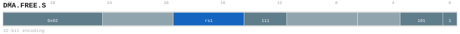

# DMA.FREE.S

<div class="insn-header">

<span class="badge-32">32-bit Base</span> **Group:** <a href="../groups/amo.md">AMO</a> &nbsp;|&nbsp;
<span class="ch-tag ch-tag-14">Ch 14</span>
&nbsp; <strong>AMO — Atomic Memory Operations</strong> &nbsp;|&nbsp;
**Length:** <code>32</code> &nbsp;|&nbsp; **Decode:** <code>—</code>

</div>

## Assembly Syntax

- `dma.free.s [SrcL]`

## Encoding

<div class="enc-diagram">

<figure>

<figcaption>Bitfield encoding diagram. MSB is on the left, LSB on the right.</figcaption>
</figure>

</div>

## Description

v0.58 32-bit DMA free-short variant: releases the DMA resources designated by the address in SrcL under the short-release semantics. Uses reserved DMA sub-class selector 31..25=0000010.

## Pseudocode (informative)

```c
// Execute DMA.FREE.S as defined by the AMO semantics.
```

## Encoding Notes

- `v0.58 32-bit DMA free-short variant: releases the DMA resources designated by the address in SrcL under the short-release semantics. Uses reserved DMA sub-class selector 31..25=0000010.`

## Full Catalog Forms

| Assembly | Length | Decode |
|----------|--------|--------|
| `dma.free.s [SrcL]` | 32 | — |

<div class="insn-nav">

← [AMO](../groups/amo.md) &nbsp;&nbsp; [Index](../index.md) &nbsp;&nbsp; [All instructions](index.md) →

</div>
