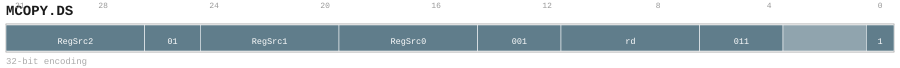

# MCOPY.DS

<div class="insn-header">

<span class="badge-32">32-bit Base</span> **Group:** <a href="../groups/bundle_split.md">Bundle Split</a> &nbsp;|&nbsp;
<span class="ch-tag ch-tag-04">Ch 04</span>
&nbsp; <strong>Block ISA — Block-structured Control Flow</strong> &nbsp;|&nbsp;
**Length:** <code>32</code> &nbsp;|&nbsp; **Decode:** <code>—</code>

</div>

## Assembly Syntax

- `MCOPY.DS [RegSrc0, RegSrc1, RegSrc2], ->{t, u, Rd}`

## Encoding

<div class="enc-diagram">

<figure>

<figcaption>Bitfield encoding diagram. MSB is on the left, LSB on the right.</figcaption>
</figure>

</div>

## Description

v0.58 32-bit block memory-copy variant in Store mode (D + S/L=Store): copies RegSrc2 bytes from the source address in RegSrc1 to the destination address in RegSrc0 and writes the resulting L2SPM replica address to RegDst; the response may return before the copy completes. Distinguished from MCOPY by 26..25=01 and the RegDst field.

## Pseudocode (informative)

```c
// Execute MCOPY.DS as defined by the Bundle Split semantics.
```

## Encoding Notes

- `v0.58 32-bit block memory-copy variant in Store mode (D + S/L=Store): copies RegSrc2 bytes from the source address in RegSrc1 to the destination address in RegSrc0 and writes the resulting L2SPM replica address to RegDst; the response may return before the copy completes. Distinguished from MCOPY by 26..25=01 and the RegDst field.`

## Full Catalog Forms

| Assembly | Length | Decode |
|----------|--------|--------|
| `MCOPY.DS [RegSrc0, RegSrc1, RegSrc2], ->{t, u, Rd}` | 32 | — |

<div class="insn-nav">

← [Bundle Split](../groups/bundle_split.md) &nbsp;&nbsp; [Index](../index.md) &nbsp;&nbsp; [All instructions](index.md) →

</div>
